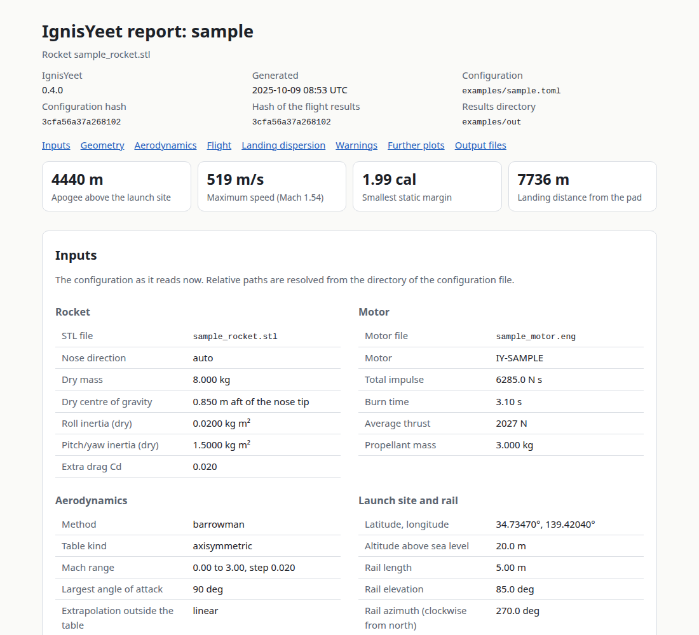
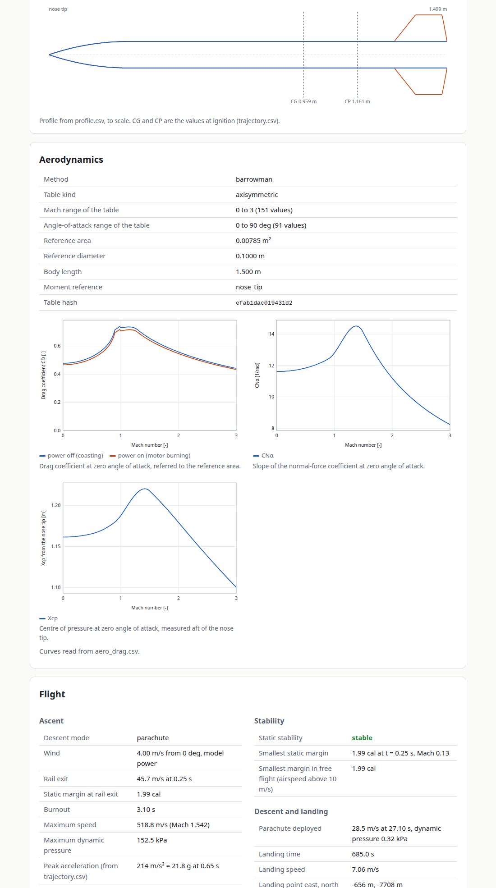

<div align="center">


# IgnisYeet

**A rocket simulator that estimates aerodynamics from the rocket's CAD data, flies the rocket in 6 degrees of freedom, and computes the landing dispersion**

[](https://github.com/ddd3h/ignisyeet/actions/workflows/docs.yml)
[](https://www.ddd3h.com/ignisyeet/)
[](LICENSE)
[](CITATION.cff)

[](https://www.rust-lang.org/)
[](https://www.python.org/)
[](https://docs.astral.sh/uv/)
[](https://www.sphinx-doc.org/)
[](#installation)
[](#output-files)
[](CITATION.cff)
</div>

Given the rocket's **CAD data**, mass properties, a motor thrust curve and launch-site conditions, IgnisYeet:

1. extracts the body radius distribution and the fin dimensions from the CAD model;
2. computes the aerodynamic coefficients once on a grid of Mach number and angle of attack (and sideslip for a six-component table) and stores them as a coefficient table;
3. flies the rocket in **6 degrees of freedom**, interpolating the coefficient table;
4. computes the **spread of landing points** with a grid of wind speeds and directions, or with Monte Carlo sampling;
5. plots the results and writes a KML file for Google Earth.

The heavy parts (geometry extraction, coefficient tables, the 6-DoF integration, the parallel dispersion) are written in Rust; plotting is written in Python (matplotlib).

The documentation is in Japanese: <https://www.ddd3h.com/ignisyeet/> (sources in [`doc/`](doc/)). It is one book: a quick start, usage, the configuration keys, workflows, the models behind every option, and the verification and validation results, with the error and warning codes in an appendix. The links below point to its main chapters.

## Features

- **Geometry from CAD data**: the rocket is given as a STEP, IGES or BREP file (`rocket.cad`, tessellated before extraction; reading it needs gmsh with its Python module from the CFD tools) or as an STL (`rocket.stl`, for tools that only export meshes). Principal-axis detection, radius distribution, automatic detection of the fins (manual override possible).
- **Aerodynamic models**: Barrowman method, panel method (Morino subsonic, local inclination supersonic), CFD with SU2 (Euler or RANS; surface from the extracted geometry, the STL or a STEP model), and external coefficient tables.
- **Six-component quasi-steady aerodynamics**: damping, apparent mass, Magnus force, induced roll, fin cant, roll-resonance check.
- **6-DoF flight**: flat or rotating Earth, US Standard Atmosphere 1976, constant/power/log/profile winds, RK4, RK45 and DOP853 integrators, ballistic, parachute and dual-deploy descent.
- **Landing dispersion**: wind grid and Monte Carlo with error ellipses and percentiles of the landing distance, and a documented procedure for a keep-out distance.
- **Output**: CSV and JSON files, KML for Google Earth, readable terminal output with progress bars.

Limits and assumptions of the models are listed in the [limitations](https://www.ddd3h.com/ignisyeet/limitations.html) page. The results are model results. Only the supersonic Basic Finner range data have been compared with measurements ([validation](https://www.ddd3h.com/ignisyeet/validation.html)); all other comparisons are cross-checks between methods or between programs (the ascent of the sample rocket is also compared with OpenRocket and RocketPy).

## Screenshots


## Requirements

| Software | Purpose |
|---|---|
| Rust (stable) and `cargo` | Building the main program |
| [uv](https://docs.astral.sh/uv/) and Python 3.10 or later (`venv` and `pip` also work) | Plotting |
| SU2 8.3.0, gmsh (Python API), Open MPI, manifold3d | Only for `aero.method = "cfd"` |

## Installation

One-line installer (Linux x86_64 / aarch64, macOS Intel / Apple Silicon; on Windows use WSL):

```sh
curl -fsSL https://raw.githubusercontent.com/ddd3h/ignisyeet/main/install.sh | bash
```

The installer asks whether you are a **user** or a **developer**, installs only what is missing, and can install the optional CFD tools. The steps, options, environment variables and uninstalling are described in the [installation chapter](https://www.ddd3h.com/ignisyeet/install.html).

To build from source:

```sh
git clone https://github.com/ddd3h/ignisyeet.git
cd ignisyeet
cargo build --release          # produces target/release/ignisyeet
```

## Quick start

Run the pipeline on the bundled sample rocket:

```sh
ignisyeet sim examples/sample.toml        # one flight: trajectory.csv, summary.json
make all                                  # aero, sim, dispersion and plots from a source checkout
make all CONFIG=my/rocket.toml            # your own configuration file
```

The [tutorial](https://www.ddd3h.com/ignisyeet/quickstart.html) walks through the first run. Before the results are used to set a keep-out distance, read the [keep-out procedure](https://www.ddd3h.com/ignisyeet/workflows.html#sec-dispersion-safety).

## Commands

```text
ignisyeet [-q|--quiet] [--no-progress] <command> ...
```

| Command | Description |
|---|---|
| `geom <config>` | Extracts the geometry from the rocket's CAD file or STL (`geometry.json`, `profile.csv`) |
| `aero <config> [--force]` | Builds the aerodynamic coefficient table (reused when the inputs are unchanged) |
| `sim <config> [--descent ballistic\|parachute]` | Flies once with the configured wind (`trajectory.csv`, `summary.json`) |
| `dispersion <config>` | Computes the landing dispersion in parallel (`dispersion.mode`) |
| `report <config> [--out DIR] [--output FILE] [--no-plots]` | Writes one self-contained HTML report (`report.html`) from the result files of the output directory; nothing is recomputed. With `output.html = true` in the configuration, `geom`, `aero`, `sim` and `dispersion` write the same report when they finish |
| `cfd-check <config> [--mesh]` | Checks the CFD tools; `--mesh` also builds the volume mesh and reports its quality |
| `sample-stl <path>` | Writes the STL of the bundled sample rocket |

The HTML report is one self-contained file (inline SVG, no scripts) with the inputs, geometry, aerodynamics, flight, landing dispersion and warnings:

<p align="center"> </p>

Every configuration key can be overridden for one run with `--set KEY=VALUE`, and the output directory with `--out DIR`. See the [command-line reference](https://www.ddd3h.com/ignisyeet/usage.html) and the [configuration reference](https://www.ddd3h.com/ignisyeet/config.html).

## Documentation

| Chapter | Content |
|---|---|
| [Getting started](https://www.ddd3h.com/ignisyeet/quickstart.html) | Install and fly the sample rocket |
| [Usage](https://www.ddd3h.com/ignisyeet/usage.html) | Commands, output files, exit status, plots and KML |
| [Configuration](https://www.ddd3h.com/ignisyeet/config.html) | Every configuration key, with type, default and range |
| [Workflows](https://www.ddd3h.com/ignisyeet/workflows.html) | Own rocket, motor, wind, dispersion, keep-out distance |
| [CFD](https://www.ddd3h.com/ignisyeet/cfd_usage.html) | Building aerodynamic tables with CFD |
| [Models](https://www.ddd3h.com/ignisyeet/intro.html) | Coordinates, geometry, aerodynamics, environment, dynamics, descent, dispersion |
| [Verification and validation](https://www.ddd3h.com/ignisyeet/verification.html) | Evidence for each model and its limits |
| [Error and warning codes](https://www.ddd3h.com/ignisyeet/errors/index.html) | Every error and warning, with its cause and fix |
| [Developer guide](https://www.ddd3h.com/ignisyeet/development.html) | Crate architecture, build, tests, release |

To build the HTML or PDF version from `doc/` (Sphinx), see the [developer guide](https://www.ddd3h.com/ignisyeet/development.html):

```sh
cd doc && make html     # doc/build/html/index.html
cd doc && make pdf      # doc/build/latex/ignisyeet.pdf
```

## Development

`cargo test --release`, `cargo clippy --all-targets -- -D warnings` and `cargo fmt --all -- --check` must pass. A release is made by pushing a tag equal to the workspace version; see the [developer guide](https://www.ddd3h.com/ignisyeet/development.html).

## License

IgnisYeet is free software under the **GNU General Public License, version 3 or later** (`GPL-3.0-or-later`; full text in [`LICENSE`](LICENSE), no warranty). Copyright (C) 2025-2026 西濱大将 (NISHIHAMA Daisuke).

As an additional term under section 7(b) of the GPLv3, the attribution "IgnisYeet by 西濱大将 (NISHIHAMA Daisuke)" and the copyright notice must be preserved in the source files, the documentation and the program's startup banner and `--version` output, and modified versions must be marked as changed. The exact wording is in [`NOTICE`](NOTICE).

## Citation and contact

These are polite requests, **not conditions of the license**. If you use IgnisYeet in publications, reports or presentations, please cite it ([`CITATION.cff`](CITATION.cff); GitHub shows a "Cite this repository" button). If you use it in a project or a derived work, please let the author know. For bug reports and feature requests, open an [issue](https://github.com/ddd3h/ignisyeet/issues) or write to `daisukenishihama63@gmail.com`.
