<div align="center">


# IgnisYeet

**A rocket simulator that estimates aerodynamics from an STL file, flies the rocket in 6 degrees of freedom, and computes the landing dispersion**

[](https://github.com/ddd3h/ignisyeet/actions/workflows/docs.yml)
[](https://www.ddd3h.com/ignisyeet/)
[](LICENSE)
[](CITATION.cff)

[](https://www.rust-lang.org/)
[](https://www.python.org/)
[](https://docs.astral.sh/uv/)
[](https://www.sphinx-doc.org/)
[](#installation)
[](#output-files)
[](CITATION.cff)
</div>

Given a rocket **STL file**, mass properties, a motor thrust curve, and launch-site conditions, IgnisYeet runs the following pipeline:

1. Extracts the body radius distribution and the fin dimensions from the STL
2. Computes the aerodynamic coefficients once on a grid of Mach number and angle of attack (and sideslip for a six-component table), and stores them as a coefficient table
3. Flies the rocket in **6 degrees of freedom**, interpolating and extrapolating the coefficient table
4. Computes the **spread of landing points** with a grid of wind speeds and directions, or with Monte Carlo sampling
5. Plots the results and writes a KML file that can be viewed in Google Earth

The computationally heavy parts (mesh slicing, the aerodynamic coefficient table, the 6-DoF integration, and the parallel landing dispersion) are written in Rust. Plotting is written in Python (matplotlib).

日本語のドキュメント（式・図・検証）は [`doc/`](doc/) にあり、https://www.ddd3h.com/ignisyeet/ で公開されています。使い方は [Usage](https://www.ddd3h.com/ignisyeet/usage.html)、HTML/PDF のビルド方法は [Documentation](#documentation) を参照してください。
Detailed documentation with equations, figures, and verification is available in Japanese at <https://www.ddd3h.com/ignisyeet/> (sources in [`doc/`](doc/)). See [Usage](https://www.ddd3h.com/ignisyeet/usage.html) for usage and [Computation flow](https://www.ddd3h.com/ignisyeet/overview.html) for the computation flow. How to build the HTML and PDF versions is described in [Documentation](#documentation).

## Features

- **Geometry extraction from STL**: principal-axis detection, per-section radius distribution, and automatic estimation of the number and dimensions of fins (manual override is possible)
- **Three aerodynamic models**: Barrowman method (including Niskanen's supersonic and drag extensions), panel method (Morino method for subsonic, local-inclination method for supersonic), and external coefficient tables (e.g. from CFD)
- **Six-component quasi-steady aerodynamics**: the coefficient table is either axisymmetric (CN, CA, center of pressure, damping sums, roll terms as a function of Mach number and total angle of attack) or general (CX, CY, CZ, Cl, Cm, Cn as a function of Mach number, angle of attack alpha and sideslip beta; made by `aero.table_kind = "general"`, by CFD with `surface = "stl"` or sideslip cases, or supplied as an external table). Roll comes from the fin cant forcing (`fin_cant_deg`, `fin_override.cant_deg`) and the roll damping Clp. The rigid-body motion is full 6-DoF, but the aerodynamics are quasi-steady with diagonal rate damping (Clp, Cmq, Cnr); cross derivatives (for example Clq or Cmp) are not modelled
- **CFD mode** (`aero.method = "cfd"`): an optional fourth route that meshes the geometry with gmsh and solves a steady (Mach, angle of attack, optionally sideslip) matrix with SU2 (Euler by default, Roe/MUSCL scheme, parallel MPI cases with warm starts, resume and an early stop on converged forces). The solved points are interpolated onto the same coefficient table, so the flight simulation is unchanged. The wall is either rebuilt from the extracted body and fins as an OpenCASCADE solid (`surface = "cad"`, alias `"panel_mesh"`) or taken **directly from the STL** (`surface = "stl"`): the shells are repaired, united with Manifold into one solid and remeshed, and a fidelity report states how far the CFD wall is from the input. The CFD wall is close to, but not identical to, the input STL (shell union, remeshing, and for Euler the base treatment `base_treatment = "fairing"` or `"flat"`). Mirror symmetry of the STL is verified before a half or quarter domain is used; otherwise the full domain is solved. Sideslip cases (`betas_deg`) and roll-damping cases (`roll_damping`) give a six-component table. It needs SU2 8.3.0, gmsh, Open MPI and, for `surface = "stl"`, manifold3d (for example from conda-forge and pip; check with `ignisyeet cfd-check <config>`), and takes tens of minutes for a small matrix; see [CFD chapter](https://www.ddd3h.com/ignisyeet/cfd.html). The RANS option is unverified and should not be relied on. The results are cross-checks against the other methods, not validation against measurements (see [CFD](#cfd))
- **Cached coefficient table**: not recomputed if the inputs are unchanged (the cache key includes the program version, a model version and the extracted geometry, and ignores settings that do not change the coefficients, such as unused method blocks and CFD resource and path settings); interpolated inside the range. Mach number is always held at the table edge; angle of attack and sideslip beyond the table are extrapolated linearly (or clamped, `extrapolation = "clamp"`) with bounds that keep signs and ranges physical
- **6-DoF flight**: flat Earth (local ENU) and rotating Earth (ECEF, with Coriolis and centrifugal forces); constant, inverse-square, and J2 gravity; full inertia tensor (products of inertia), lateral CG offset, thrust misalignment and nozzle offset, and launch roll about the rail axis
- **Atmosphere and wind models**: US Standard Atmosphere 1976 (with optional temperature offset) and a constant atmosphere; constant, power-law, logarithmic, and altitude-table winds
- **Integrators**: fixed-step RK4 and adaptive-step RK45 (Dormand-Prince) and DOP853; attitude propagation by quaternion renormalization or a Lie-group (RKMK) update; the apogee is interpolated (cubic Hermite) with every integrator, and a diverged state (non-finite, above 8 km/s or 1000 km) stops the run with an error
- **Landing dispersion**: a wind grid (speed x direction) and Monte Carlo sampling (1-sigma and 3-sigma error ellipses, P50/P90/P99 of the landing distance), computed in parallel and evaluated for both ballistic descent and parachute descent. Cases and samples that do not land within `sim.max_time` count as failed: the statistics are flagged incomplete, the maximum landing distance is reported as a lower bound, and the exit status is 3. Statistics without enough landed samples are `null` (the mean needs one, the standard deviation, covariance and ellipses two). Monte Carlo perturbs thrust, burn time, dry mass, CG, CN, CA, rail angles, wind and parachute, and optionally thrust misalignment, nozzle offset, fin cant, lateral CG, roll moment (Cl) and roll damping (Clp)
- **KML output**: launch site, flight path, and landing-point distributions overlaid in Google Earth
- **Readable terminal output**: configuration summary, progress bars with ETA, and result panels in color (plain output is selected automatically when piped)
- **Sphinx documentation**: Japanese documentation (HTML and PDF)

## Screenshots

### Terminal output

At startup, the contents of the configuration file are shown grouped by item, so you can check units and wind directions before the run.

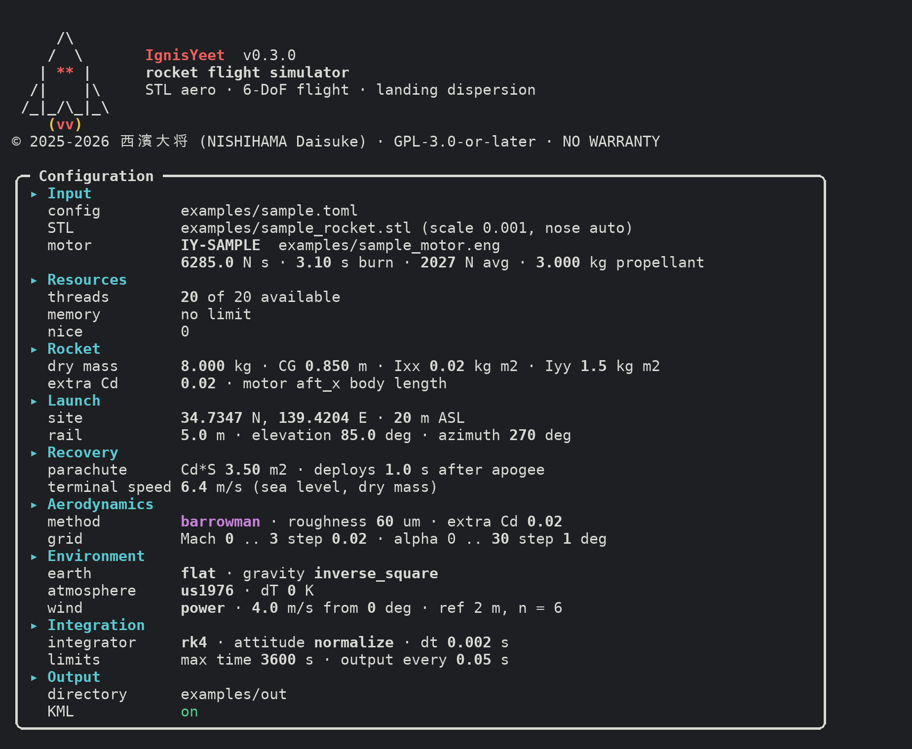

When the flight computation finishes, a result panel and the list of output files are shown. The static margin row (`min margin`: the smaller of the free-flight minimum after rail exit and the rail-exit value) carries a verdict mark (green at 1.5 cal or more, a warning below 1.5 cal, `low static margin` below 1.0 cal, `UNSTABLE` below 0 cal). With dual deploy a `main deploy` row gives the height and time of the main parachute.

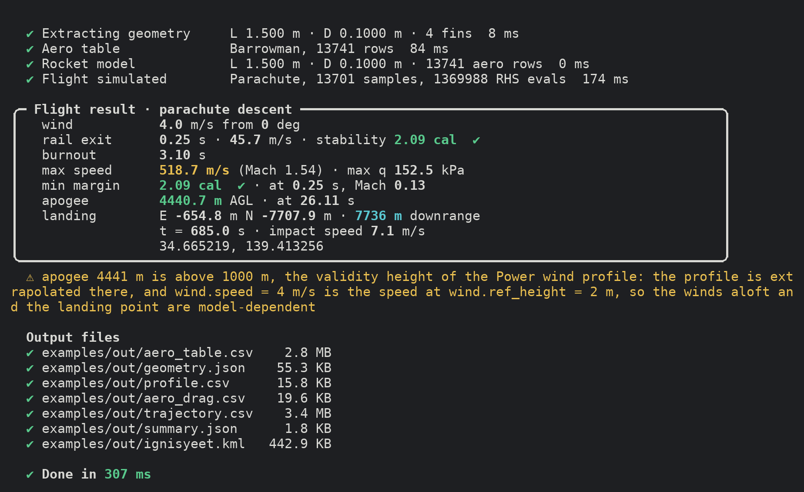

Heavy computations show a progress bar, an ETA, and intermediate results.

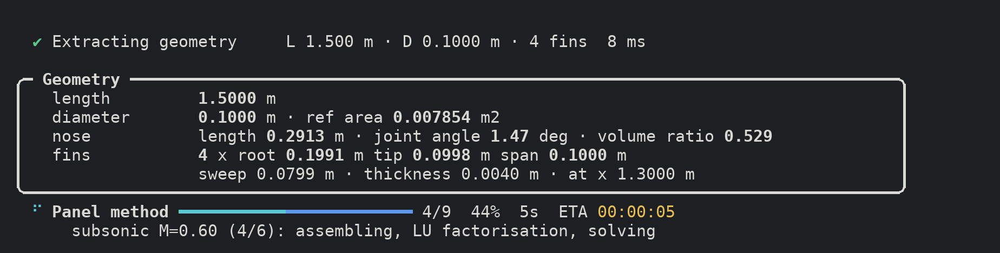

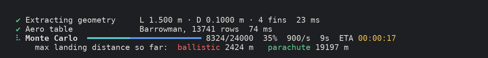

### Result figures

All of the following are results for the bundled sample rocket (100 mm diameter, 1.5 m long, four fins), drawn by `python/plot.py`.

**Geometry extracted from the STL** (body outline, detected fins, center of pressure)

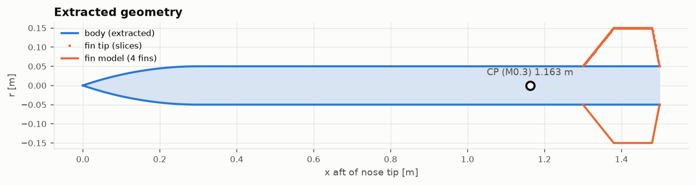

**Aerodynamic coefficients** (breakdown of zero-lift drag, slope of the normal-force coefficient, center of pressure, normal force versus angle of attack)

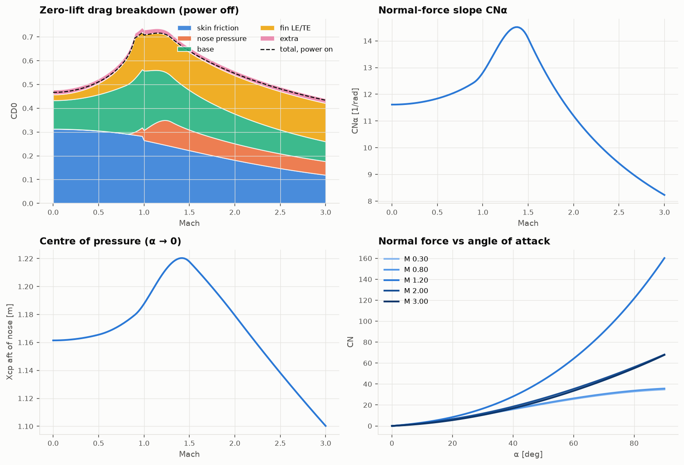

**Flight time history** (altitude, speed, Mach number, angle of attack, static margin, dynamic pressure, thrust, mass, pitch angle, sideslip angle, roll rate)

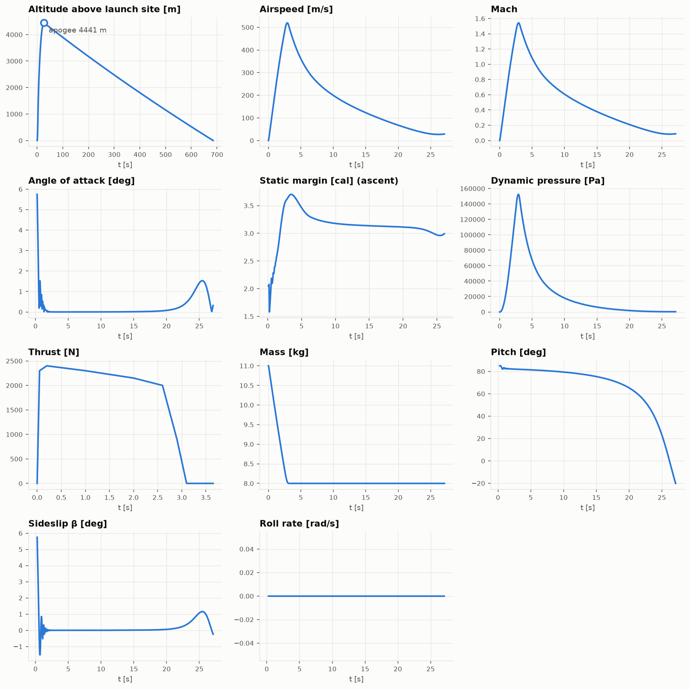

**3-D flight path** (rail, free flight, and parachute descent are color-coded)

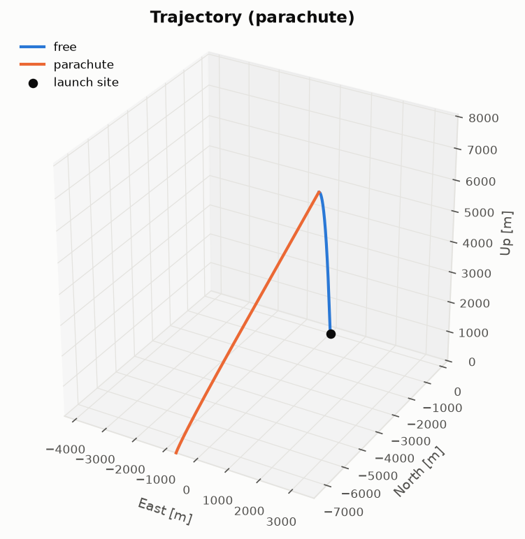

**Landing dispersion on a wind grid** (landing points for each wind speed x direction; ballistic descent on the left, parachute descent on the right)

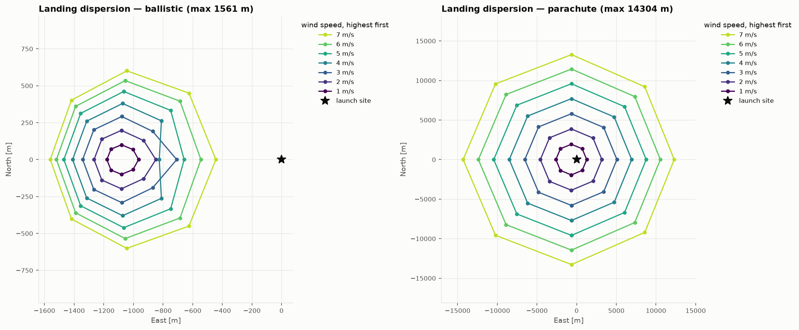

**Landing dispersion by Monte Carlo** (1000 samples, 1-sigma and 3-sigma error ellipses, RK45; 1000 landing points of ballistic descent on the left and of parachute descent on the right)

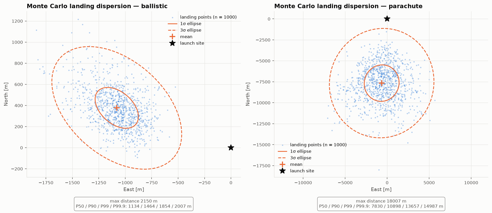

**Surface pressure coefficient Cp from the panel method** (angle of attack 4 degrees, lowest subsonic Mach number; developed body surface and both sides of the fins)

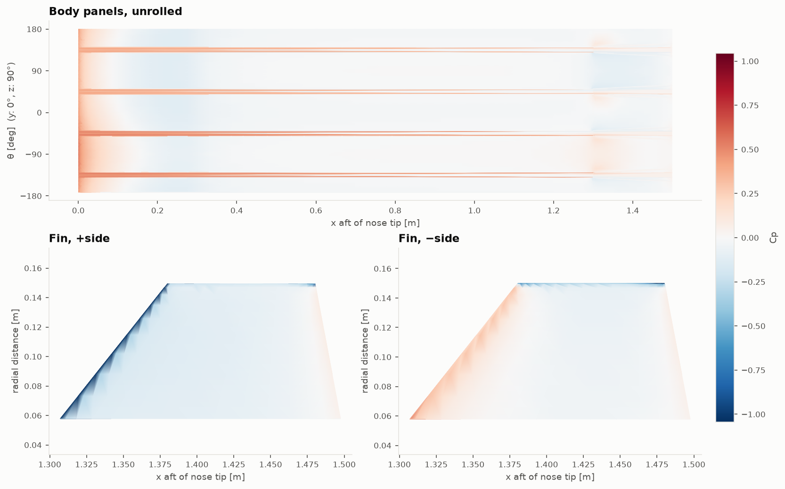

## CFD

With `aero.method = "cfd"`, IgnisYeet solves the flow around the rocket with SU2 (Euler equations by default) for a matrix of Mach number, angle of attack and, optionally, sideslip, and builds the coefficient table from the wall pressure. The flight simulation is unchanged. The wall geometry is either rebuilt from the extracted body and fins (`surface = "cad"`) or taken directly from the STL (`surface = "stl"`; the shells are repaired, united by a Manifold boolean union and remeshed, and a fidelity report states how far the CFD wall is from the input). Set up the tools (see [Requirements](#requirements)), check them, and run the CFD example:

```sh
./target/release/ignisyeet cfd-check examples/sample_cfd.toml --mesh   # tools, versions, case count, mesh quality
./target/release/ignisyeet aero      examples/sample_cfd.toml          # runs the SU2 cases (cached and resumable)
```

[`examples/sample_cfd.toml`](examples/sample_cfd.toml) is a reduced matrix (4 Mach x 3 angles of attack, Euler, 2 mm surface mesh). On a 20-thread desktop it takes about 15 to 20 minutes (a measured 16-case matrix with 0.94 M cells per case took about 22 minutes). The commented options in that file cover sideslip (`betas_deg`), roll damping (`roll_damping`), mirror-symmetry handling (`shape_symmetry`), the Euler base treatment of an STL (`base_treatment`) and the early stop (`min_iterations`, `stable_window`).

The figures below are for the bundled sample rocket (Euler, 2 mm surface mesh). **The labels inside these figures are in Japanese.**

**Mach number on the symmetry plane** (angle of attack 4 degrees; M = 0.8 on top, M = 2.0 below)

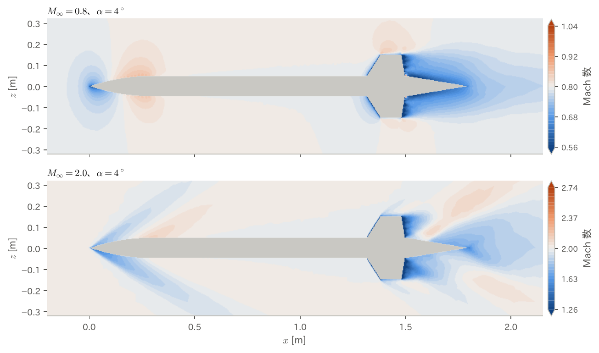

**Wall pressure coefficient Cp**

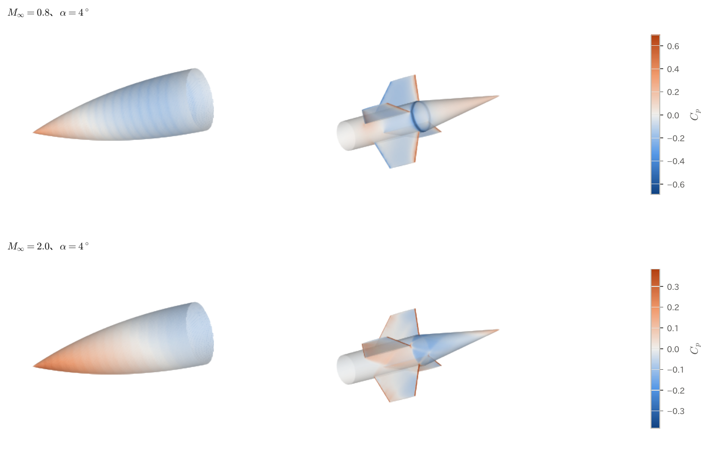

**Surface mesh** (near the nose tip and at the fin root)

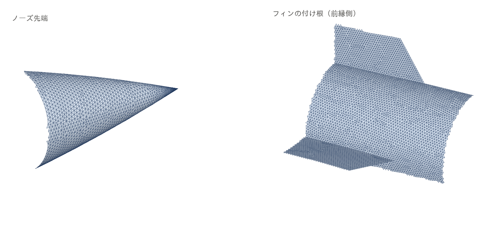

**Direct-STL CFD compared with the rebuilt geometry and the Barrowman method** (CN, center of pressure, roll damping Clp)

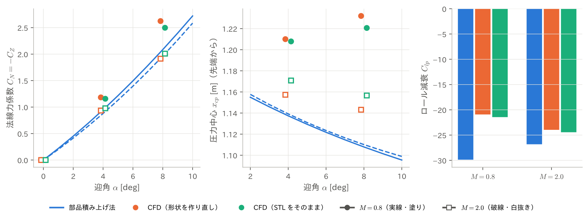

What the CFD results are, and are not:

- **Cross-checks only.** The CFD in direct-STL mode and the CFD on the rebuilt geometry differ by 5 to 9 % in CN. For the roll damping at M = 0.8, Clp is -19.4 (STL CFD) and -21.0 (rebuilt CFD) against -29.9 from the Barrowman method. These are comparisons between methods, not validation against measurements; no comparison with a real rocket has been made.
- **Euler (inviscid).** Skin friction and base drag are not obtained from CFD and are added from the Barrowman model, as is the fin-edge drag for `surface = "cad"`; with `surface = "stl"` the fin faces are part of the CFD wall, so the fin-edge term is not added. The CFD wall is close to, but not identical to, the input STL; read the fidelity report before using a result. With the Euler solver an STL needs an explicit `base_treatment`: `"fairing"` adds a conical tail fairing behind the flat base (this changes the input shape), `"flat"` keeps the shape but may not converge (it did not for the sample STL).
- **RANS is unverified** and gmsh 4.15 cannot build the boundary-layer prism layers on the OpenCASCADE surfaces; use the default Euler model.
- **Mesh convergence is not established.** At M = 2 the normal-force coefficient CN is still rising on the finest meshes (0.9188 at 2 mm, 0.9259 at 1.8 mm), so the data are not in the asymptotic range; at M = 0.8 it does not converge monotonically (1.2259 at 3.5 mm, 1.2021 at 1.8 mm). The default 2 mm differs from the 1.8 mm result by 0.6 % (M = 0.8) and 0.8 % (M = 2).
- **No Mach extrapolation.** CFD tables are held at the values of the highest (lowest) solved Mach number beyond the solved range; `cfd_report.json` records `mach_clamped_above` / `mach_clamped_below` and a warning is issued.
- **Quasi-steady.** Pitch and yaw damping are not obtained from the steady solutions: the damping sums of the Barrowman (or panel) model are rescaled to the CFD normal-force slope and centre of pressure. Clp comes from the rotating-frame runs when `roll_damping` is on (otherwise from the Barrowman model); cross derivatives are not modelled. Outside the solved (alpha, beta) range of a general table the values come from the model, not from CFD.
- Tested on Linux with conda-forge SU2 8.3.0, gmsh 4.15.2, Open MPI 5.0.11 and manifold3d 3.5.4; other environments have not been tested.

Details: [CFD usage](https://www.ddd3h.com/ignisyeet/cfd.html), [CFD internals](https://www.ddd3h.com/ignisyeet/cfd_internals.html) and [verification of the aerodynamic models](https://www.ddd3h.com/ignisyeet/verification_aero.html) (all in Japanese).

## Requirements

| Software | Purpose |
|---|---|
| Rust (stable) and `cargo` | Building the main program |
| [uv](https://docs.astral.sh/uv/) and Python 3.10 or later (`venv` and `pip` also work instead of uv) | Plotting (numpy, pandas, matplotlib) |
| SU2 8.3.0, gmsh (Python API), Open MPI, manifold3d | Only for `aero.method = "cfd"` (manifold3d only for `surface = "stl"`); see [CFD](#cfd) |
| LuaLaTeX (luatexja), dvisvgm | Only for building the TikZ figures of the documentation |
| upLaTeX, dvipdfmx, latexmk, inkscape | Only for building the PDF version of the documentation |

## Installation

One-line installer (Linux x86_64 / aarch64, macOS Intel / Apple Silicon; on Windows, use WSL and the Linux instructions; the CFD mode needs a Unix-like system (Linux, macOS, WSL), while the rest of the workspace also passes `cargo check` on Windows):

```sh
curl -fsSL https://raw.githubusercontent.com/ddd3h/ignisyeet/main/install.sh | bash
```

The installer asks whether you are a **user** or a **developer**, shows which tools it already found (cargo, uv, python3, git, conda/micromamba, an existing `ignisyeet-cfd` environment, SU2, gmsh, TeX, ...), and installs only what is missing. Nothing is reinstalled when it is already present, and re-running it is safe.

| Role | What is installed |
|---|---|
| user | The release binary for your platform (sha256 verified) in `~/.local/bin`, the examples and `python/plot.py` in `~/.local/share/ignisyeet/<version>` (with a `current` link), a plotting environment (uv, or `venv` + pip), and an `ignisyeet-plot` command. No documentation tools. |
| developer | A git clone (default `~/ignisyeet`, or the clone you run it from), Rust via rustup if `cargo` is missing, uv, `cargo build --release`, `cargo test --release`, the `python/` and `doc/` environments. Missing documentation tools (TeX Live, dvisvgm, mutool, inkscape, IPAex fonts) are listed with the exact `apt` / `brew` command; the installer never runs `sudo`. |

Both roles can additionally install the CFD tools (SU2, gmsh, Open MPI from conda-forge, about 3 GB, plus manifold3d from pip for `surface = "stl"`) into a conda environment named `ignisyeet-cfd`. The versions are pinned on all platforms (SU2 8.3.0, gmsh 4.15.2, Open MPI 5, Python 3.10; micromamba 2.9.0 when it has to be installed) because the SU2 8.5.0 package crashes on CPUs without AVX-512. An existing micromamba/mamba/conda and an existing environment are reused. The plotting environment is installed from the locked versions (`uv.lock`, or `scripts/plot-constraints.txt` with pip). The installer prints the `[aero.cfd] prefix` value to put in your configuration (or `IGNISYEET_CFD_PREFIX`).

Options are given after `bash -s --`:

```sh
curl -fsSL https://raw.githubusercontent.com/ddd3h/ignisyeet/main/install.sh | bash -s -- --developer --cfd -y
```

| Option | Meaning |
|---|---|
| `--user` / `--developer` | Choose the role without asking |
| `--cfd` / `--no-cfd` | Install or skip the optional CFD tools |
| `--version vX.Y.Z` | Release to install (default: the latest GitHub release); developer: tag to check out. Only the form `vX.Y.Z` is accepted |
| `--prefix DIR` | Install prefix (default `~/.local`) |
| `--dir DIR` | Developer clone location |
| `--no-test` | Developer: skip `cargo test` |
| `--add-path` | Append the `PATH` line to your shell rc file (never done silently) |
| `--force` | Reinstall even if the same version is installed |
| `-y`, `--yes` | No questions; defaults (user, no CFD, no rc-file edit) |
| `--dry-run` | Show the plan and exit |
| `--uninstall` | Remove the binary, links and release data; asks before removing the plotting environment and the CFD environment (`--purge` removes both). A developer clone is deleted only after an explicit confirmation |
| `--no-color`, `--help` | Plain output; usage |

Every option also has an environment variable (`IGNISYEET_VERSION`, `IGNISYEET_PREFIX`, `IGNISYEET_ROLE`, `IGNISYEET_DIR`, `IGNISYEET_CFD=1|0`, `IGNISYEET_YES=1`, ...). Output follows `NO_COLOR`, falls back to ASCII on a non-UTF-8 locale and to plain lines when it is not a terminal. Everything is logged to `~/.local/share/ignisyeet/install.log`.

Releases are published on GitHub as `ignisyeet-<version>-<target>.tar.gz` with a `.sha256` file; the installer verifies the checksum before installing, and you can check it by hand with `sha256sum -c ignisyeet-<version>-<target>.tar.gz.sha256`. To read the script before running it, download it first: `curl -fsSLO https://raw.githubusercontent.com/ddd3h/ignisyeet/main/install.sh && bash install.sh`.

`--prefix` and `--dir` are made absolute at start-up (relative paths would give broken symlinks).

### Building from source

```sh
git clone https://github.com/ddd3h/ignisyeet.git
cd ignisyeet
cargo build --release          # produces target/release/ignisyeet
```

### Quick start

Run the whole pipeline (aerodynamics, flight, dispersion, plotting) on the bundled sample rocket.

```sh
make all                        # uses examples/sample.toml
make all CONFIG=my/rocket.toml  # to use your own configuration file
```

`make all` runs the targets `aero`, `sim`, `dispersion` and `plot` in order; the plots are read from the `output.dir` of the configuration file (a basic or literal TOML string). When `sim` or `dispersion` exits with status 3 (outputs written but incomplete), `make all` still makes the plots and then fails with `results are INCOMPLETE (exit status 3)` (the 3 is the `ignisyeet` status; GNU make itself exits with status 2); any other failure stops it at once. The targets run serially even under `make -j`, paths with spaces are handled, and the binary is taken from `$CARGO_TARGET_DIR/release` when that variable is set. The equivalent commands are as follows.

```sh
./target/release/ignisyeet aero       examples/sample.toml   # aero_table.csv/.json, aero_drag.csv
./target/release/ignisyeet sim        examples/sample.toml   # trajectory.csv, summary.json
./target/release/ignisyeet dispersion examples/sample.toml   # dispersion.csv
uv run --project python python/plot.py all examples/out      # plots/*.png
```

`make geom` extracts the geometry on its own (geometry.json, profile.csv), and `sim --descent ballistic` flies the ballistic descent.

Before the results are used to set a keep-out distance, read the [procedure for keep-out studies](https://www.ddd3h.com/ignisyeet/dispersion.html#sec-dispersion-safety) (the radius is the largest landing distance over all wind-grid cases and all Monte Carlo samples, for ballistic and parachute descent, plus a margin; wind-grid speeds are speeds at `wind.ref_height` for the `constant`, `power` and `log` models and the profile mean speed for `profile`; dual-deploy settings) and the [limitations](https://www.ddd3h.com/ignisyeet/limitations.html) (Japanese). The results are model results; no comparison with a real flight has been made.

To plot with `pip` instead of uv, create a virtual environment first.

```sh
python3 -m venv .venv && . .venv/bin/activate
pip install -r python/requirements.txt -c scripts/plot-constraints.txt
python python/plot.py all examples/out
# via make: make plot PLOT="python python/plot.py"
```

`sim` and `dispersion` run `aero` automatically when there is no coefficient table, or when the STL or the aerodynamic settings have changed. The table is also rebuilt when the program version or the model version changes; `aero --force` rebuilds it unconditionally.

## Commands

```text
ignisyeet [-q|--quiet] [--no-progress] <command> ...
```

| Command | Description |
|---|---|
| `geom <config>` | Extracts the geometry from the STL and writes `geometry.json` and `profile.csv` |
| `aero <config> [--force]` | Builds the aerodynamic coefficient table. If the inputs are the same as last time, the stored table is used; `--force` always rebuilds it |
| `sim <config> [--descent ballistic\|parachute]` | Flies once with the configured wind and writes `trajectory.csv` and `summary.json`; exits with status 3 when the rocket does not land within `sim.max_time` or is statically unstable |
| `dispersion <config>` | Computes the landing dispersion in parallel according to `dispersion.mode`; exits with status 3 when cases or samples fail or do not land or the nominal ballistic flight is statically unstable; exits with status 1 when every wind-grid case stops with an error |
| `cfd-check <config> [--mesh]` | Checks that SU2, MPI and gmsh (and manifold3d for `surface = "stl"`) are installed (exit status 1 if a required tool is missing), reports their versions and the number of CFD cases; `--mesh` also exports the wall surface, builds the volume mesh and reports node/cell counts and quality (and the STL fidelity for `surface = "stl"`) |
| `sample-stl <path>` | Writes the STL of the bundled sample rocket (tangent ogive, four trapezoidal fins, in mm, nose pointing +z) |

| Global option | Description |
|---|---|
| `-q`, `--quiet` | Prints only errors and the paths of the written files (for scripts) |
| `--no-progress` | Does not draw progress bars and spinners (the boxed summaries are still shown) |

`--version` prints the version together with the copyright and license notice.

**Exit status.** 0 success; 1 error (invalid configuration, missing input, failed step including a diverged integration (also a speed above 8 km/s or a height above 1000 km), missing CFD tools, a wind grid in which every case stopped with an error); 2 usage error; 3 the run finished and wrote its outputs but the results are incomplete or not usable (a flight did not land within `sim.max_time`, or dispersion cases or samples failed or did not land, including wind-grid cases whose integration stopped with an error: a line `INCOMPLETE RESULTS` is printed to stderr; or the rocket is statically unstable, i.e. the smaller of the free-flight minimum static margin and the rail-exit value is below 0 cal, for `sim` whether or not it landed and for `dispersion` judged on the nominal ballistic flight: a line `RESULTS NOT USABLE: the rocket is statically UNSTABLE (min static margin … cal)` is printed to stderr and `stable` and `static_margin_min_cal` in `summary.json`, `dispersion_meta.json` and `dispersion_summary.json` give the value).

**Validation and warnings.** Every numeric configuration key is range-checked, non-finite values (`nan`, `inf`) are rejected, and the message names the key (and the file and line for input files). The full list of checks is in the [documentation](https://www.ddd3h.com/ignisyeet/usage.html#sec-config-checks) (in Japanese).

- **Errors** (exit status 1): unknown keys; values outside their bounds (for example `sim.dt` above 0.05 s, `sim.rtol` or `sim.atol` above 1e-3, `aero.mach_max` above 10, `aero.n_slices` outside 20 to 10000, `dispersion.directions` above 360, an empty `dispersion.wind_speeds`, more than 1e6 Monte Carlo samples); `rocket.cg_dry` outside the body or a body length outside 0.1 to 20 m; `motor.aft_x` placing the motor outside the body (it must lie between the motor length and the body length); `wind.direction_deg` or a wind profile direction outside 0 to 360 degrees; `sim.output_interval` below 1e-4 s or `sim.max_time / sim.output_interval` above 1e7; a truncated binary STL; `recovery.cd_s` of 0 with recovery enabled; an incomplete dual-deploy pair; a calm wind profile (mean speed below 0.1 m/s) used for a wind grid or a nonzero wind sigma (the message for Monte Carlo names the wind perturbations); a missing or invalid input file (STL, `.eng`, external aero table, wind profile).
- **Warnings** (printed in every output mode, stderr with `-q`, and stored in `summary.json`, `dispersion_meta.json` and `dispersion_summary.json` as `warnings`): a body diameter outside 0.005 to 3 m; a static margin below 1.5 cal (`marginal`), below 1.0 cal (`low static margin`) or below 0 cal (`UNSTABLE`); an apogee above 1000 m with the `power` or `log` wind, or above the top of a wind profile table; a wind profile scaled by a factor above 3 or below 1/3; a parachute descent that landed without deploying or faster than 15 m/s; a motor thrust curve that does not end at 0 N; wind-grid cases that stopped with an error (counted apart from the cases that did not land; the aero table lookup statistics leave them out); a flight that does not land; a dual-deploy `main_altitude` at or above the apogee; a rail exit speed below 15 m/s; a wind angle of attack at rail exit above 15 degrees; aero table lookups outside the tabulated range (also recorded as `aero_table_range`); an SU2 version other than 8.3.x; and the geometry findings in `geometry.json`.
- **Exit status**: see above (3 means the outputs were written but are incomplete or not usable).

When stdout is redirected to a pipe or a file, the output is plain line-based text without colors or boxes. The environment variable `NO_COLOR` disables colors, and `TERM=dumb` disables colors and Unicode symbols.

```sh
./target/release/ignisyeet sim examples/sample.toml -q            # only the written paths
./target/release/ignisyeet dispersion examples/sample.toml --no-progress
NO_COLOR=1 ./target/release/ignisyeet aero examples/sample.toml
```

## Configuration file (TOML)

Configuration is written in TOML. Relative paths are resolved against **the directory of the configuration file**. Lengths are in meters, and positions on the rocket are measured from the nose tip toward the tail. The quickest way to start is to copy [`examples/sample.toml`](examples/sample.toml), which lists every item with comments, and edit it. The default value and meaning of each item are summarized in [Usage](https://www.ddd3h.com/ignisyeet/usage.html) (in Japanese).

| Section | Main contents |
|---|---|
| `[output]` | Output directory `dir`, `kml` switch for the Google Earth file |
| `[resources]` | Compute resources: `threads` (CPU thread cap, 0 = all available), `memory_gb` (budget for the panel matrix and CFD cases, 0 = no limit), `nice` (0 to 19, lowers the process priority) |
| `[rocket]` | STL path and unit `stl_scale`, `nose_direction`, dry mass, center of gravity, moments of inertia (`ixx_dry`, `iyy_dry`; optional `izz_dry`, products `ixy_dry`/`ixz_dry`/`iyz_dry`, lateral CG offset `cg_lateral_dry`), `fin_cant_deg`, roughness, fin leading- and trailing-edge shapes, `extra_cd`, `[rocket.fin_override]` (manual fin specification, including `cant_deg`) |
| `[motor]` | RASP `.eng` file, motor aft position `aft_x`, nozzle exit diameter, override of the propellant mass, thrust misalignment (`misalignment_deg`, `misalignment_azimuth_deg`, `misalignment_offset`) |
| `[launch]` | Latitude, longitude, altitude, rail length (the distance the rocket travels along the rail until it leaves, i.e. the effective guide length), elevation angle, azimuth, `roll_deg` (body roll about the rail axis) |
| `[recovery]` | Whether a parachute is used (`enabled`), `cd_s`, deployment delay `delay`; optional dual deploy: `main_cd_s` and `main_altitude` (both or neither; the main canopy replaces the drogue `cd_s` when the rocket descends through `main_altitude` above the launch site) |
| `[aero]` | `method` (`barrowman`, `panel`, `table`, `cfd`), external table `table`, Mach and angle-of-attack grids, number of sections `n_slices`, `fin_threshold`, `extrapolation` (`linear`, `clamp`), `table_kind` (`axisymmetric`, `general`) and `general_mach_step` |
| `[aero.panel]` | Panel-method mesh divisions (`body_axial`, `body_circ`, `fin_chord`, `fin_span`), `wake_length`, `tail_radii`, `subsonic_machs`, `transonic`, `fin_section` |
| `[aero.cfd]` | SU2 CFD (see [CFD](#cfd)): `prefix` of the tool environment, `model` (`euler`, `rans`), `machs`, `alphas_deg`, `betas_deg`, `roll_damping`, `roll_rate_hat`, `surface` (`cad`/`panel_mesh`, `stl`), `symmetry`, `shape_symmetry`, `base_treatment`, `stl_remesh`, `max_geometry_error`, `wall_size`, `farfield`, `iterations`, `min_iterations`, `stable_window`, `cfl`, `convergence`, `scheme`, `ranks_per_case`, `parallel_cases`, `workdir`, and more; the commented block in [`examples/sample_cfd.toml`](examples/sample_cfd.toml) lists every item |
| `[earth]` | `model` (`flat`, `ecef`), `gravity` (`constant`, `inverse_square`, `j2`; `j2` requires `ecef`) |
| `[atmosphere]` | `model` (`us1976`, `constant`), `temperature_offset`, constant-atmosphere `density`, `sound_speed`, `viscosity` |
| `[wind]` | `model` (`constant`, `power`, `log`, `profile`; for `profile` the representative wind is the mean speed over the table's altitude range and the direction of its mean wind vector, and a dispersion wind grid scales the whole table to the grid speed), wind speed, wind direction (the direction the wind comes from), reference height, power-law exponent, roughness length, ground blend height `ground_blend_height` (cubic blend to zero near the ground for the `power` and `log` models), altitude table `profile` |
| `[sim]` | `integrator` (`rk4`, `rk45`, `dop853`), `attitude` (`normalize`, `lie_group`), `dt`, `rtol`, `atol`, `max_time` (default 3600 s; a run that has not landed by then is reported as a failure), `output_interval`, `descent` |
| `[dispersion]` | `mode` (`wind_grid`, `monte_carlo`), `wind_speeds`, `directions` |
| `[dispersion.monte_carlo]` | `samples`, `seed`, and 1-sigma values for thrust, burn time, dry mass, center of gravity, CN, CA, elevation, azimuth, wind, and parachute; optionally `thrust_misalignment_deg`, `thrust_offset`, `fin_cant_deg`, `cg_lateral`, `cl_scale`, `clp_scale` |

## Output files

The output directory is `output.dir` (`examples/out/` in the sample).

| File | Contents |
|---|---|
| `geometry.json`, `profile.csv` | Extracted geometry |
| `aero_table.csv`, `aero_table.json` | Axisymmetric table: CN, CA (powered and coasting), Xcp, CNalpha, pitch damping sums, fin cant forcing `cl_delta` and roll damping `clp` for each (Mach, angle of attack). General table (`kind = "general"`): CX (powered and coasting), CY, CZ, Cl, Cm, Cn, `cl_delta`, `clp` and the pitch and yaw damping sums for each (Mach, alpha, beta). The `.json` holds metadata and a hash of the inputs |
| `aero_drag.csv` | Breakdown of zero-lift drag (total only for the panel method), and the Mach dependence of CNalpha and Xcp (not written for `method = "cfd"`) |
| `cfd_cases.csv`, `cfd_report.json` | `method = "cfd"` only: one row per solved case (status, iterations, residuals, coefficients including the six components) and the run summary (failed and unconverged cases, mesh size, timing, domain and symmetry used, roll-damping source, STL fidelity). Case data and the mesh are cached in `<output.dir>/<workdir>/` (default `cfd/`); for `surface = "stl"` the mesh directory also holds `repair_report.json`, `union_report.json` and `stl_fidelity.json` |
| `panel_cp.csv` | Surface panels and Cp (angle of attack 4 degrees) when `method = "panel"` |
| `trajectory.csv`, `summary.json` | Time history and main results of a single flight. `summary.json` also has `landed`, `max_time`, `main_deploy_time` and `main_deploy_altitude` (dual deploy), `static_margin_min_cal`, `stable`, `drogue_deploy_time`, `wind_scale` (profile wind only), `config_hash`, `warnings` and `aero_table_range`; `landing_speed` is the ground-relative speed at touchdown, including horizontal drift; the landing fields are `null` when the flight did not land |
| `dispersion.csv`, `dispersion_meta.json` | Landing points of all wind-grid cases (ballistic and parachute descent), with `landed` and `error` columns (the error text of a case whose integration stopped); the sidecar holds `config_hash`, `flight_config_hash`, `cases`, `failed`, `errored`, `warnings`, `aero_table_range`, and `stable` and `static_margin_min_cal` of the nominal flight |
| `dispersion_mc.csv`, `dispersion_summary.json` | Perturbations and landing point of each Monte Carlo sample, and for each descent mode the mean, covariance, 1-sigma and 3-sigma error ellipses, P50/P90/P99 of the landing distance (`landing_distance_p50`, `_p90`, `_p99`), `failed`, `not_landed`, `complete` and `max_landing_distance_is_lower_bound`; plus `config_hash`, `flight_config_hash`, `warnings`, `aero_table_range`, and `stable` and `static_margin_min_cal` of the nominal flight |
| `ignisyeet.kml` | A single KML file for Google Earth. Folders are `Launch site`, `Flight`, `Dispersion – wind grid`, and `Dispersion – Monte Carlo` (lines only). `sim` and `dispersion` update it while merging each other's results; only results whose `config_hash` matches the current configuration are merged (stale ones are left out with a warning), and flights or cases that did not land are left out (a `sim` that does not land rewrites the file without the flight layer; Monte Carlo ellipses need at least two landed samples) |
| `plots/*.png` | Figures drawn by `python/plot.py` |

## Plotting

```sh
uv run --project python python/plot.py all <out_dir>
uv run --project python python/plot.py {geometry,aero,panel,trajectory,dispersion} <out_dir>
uv run --project python python/plot.py aero <out_dir> --compare <another output directory>
```

| Subcommand | Output |
|---|---|
| `geometry` | `geometry.png` |
| `aero` | `aero.png`. With `--compare`, also draws `aero_compare.png`, which overlays CNalpha, Xcp, and CD0 of two coefficient tables |
| `panel` | `panel.png` (when `panel_cp.csv` exists) |
| `trajectory` | `trajectory.png`, `trajectory_3d.png` |
| `dispersion` | `dispersion.png` if `dispersion.csv` exists; `dispersion_mc.png` if `dispersion_mc.csv` and `dispersion_summary.json` exist |
| `all` | All of the above (those whose input files exist) |

## Documentation

The documentation (in Japanese) is published at <https://www.ddd3h.com/ignisyeet/>; the chapters are listed in [Overview of the methods](#overview-of-the-methods). It contains equations, figures, and verification, and can also be built from `doc/` (Sphinx).

```sh
cd doc && make html     # doc/build/html/index.html
cd doc && make pdf      # doc/build/latex/ignisyeet.pdf
```

The HTML version needs uv, lualatex (luatexja), and dvisvgm. The PDF version additionally needs uplatex, dvipdfmx, latexmk, and inkscape. Without uv, install the dependencies into a virtual environment and run with an empty `PY`.

```sh
python3 -m venv .venv && . .venv/bin/activate
pip install -r doc/requirements.txt
cd doc && make html PY=     # likewise make pdf PY= for the PDF
```

## Overview of the methods

Detailed equations and derivations are in the chapters of the documentation (in Japanese).

| Stage | Summary | Chapter (Japanese) |
|---|---|---|
| Usage | Installation, configuration items and defaults, commands, outputs | [Usage](https://www.ddd3h.com/ignisyeet/usage.html) |
| Overall | Processing flow, and why the coefficient table is built first | [Computation flow](https://www.ddd3h.com/ignisyeet/overview.html) |
| Geometry extraction | Principal axis by PCA; radius distribution and fins estimated from sections perpendicular to the axis | [Geometry extraction from STL](https://www.ddd3h.com/ignisyeet/geometry.html) |
| Aerodynamics (overview) | The coefficient table that connects the aerodynamic methods to the flight simulation; axisymmetric and general tables; choosing a method; table interpolation and external tables | [Overview of the aerodynamic models](https://www.ddd3h.com/ignisyeet/aerodynamics.html) |
| Aerodynamic coefficients | Six body-axis force and moment coefficients, CN, CA and the center of pressure, alpha, beta and the total angle of attack, damping and roll derivatives | [Aerodynamic coefficients and coordinate systems](https://www.ddd3h.com/ignisyeet/aero_coefficients.html) |
| Aerodynamics (Barrowman method) | Component build-up of normal force, center of pressure, drag, and pitch damping. Supersonic by Busemann's second-order theory, transonic joined by a cubic | [Aerodynamics by the Barrowman method](https://www.ddd3h.com/ignisyeet/barrowman.html) |
| Aerodynamics (panel method) | Morino method (Goethert transformation) for subsonic, local-inclination method for supersonic, cubic Hermite interpolation between them for transonic | [Aerodynamics by the panel method](https://www.ddd3h.com/ignisyeet/panel.html) |
| Aerodynamics (CFD) | Using SU2 through the CFD mode: wall geometry from the rebuilt body or the STL, the run, how to read the outputs, how far to trust them | [Using CFD](https://www.ddd3h.com/ignisyeet/cfd.html) |
| Aerodynamics (CFD internals) | Governing equations, SU2 settings, geometry preparation, meshing, case execution, post-processing | [CFD internals and numerical methods](https://www.ddd3h.com/ignisyeet/cfd_internals.html) |
| Flight | 6-DoF rigid body with full inertia tensor, thrust misalignment, launch roll, launch-rail constraint, changes in propellant mass, center of gravity, and inertia; six-component quasi-steady aerodynamics with diagonal rate damping | [6-DoF equations of motion](https://www.ddd3h.com/ignisyeet/dynamics.html), [Thrust and mass properties](https://www.ddd3h.com/ignisyeet/propulsion.html) |
| Coordinates and environment | Flat ENU and ECEF, atmosphere, wind, gravity | [Coordinate systems and attitude](https://www.ddd3h.com/ignisyeet/coordinates.html), [Environment models](https://www.ddd3h.com/ignisyeet/environment.html) |
| Landing dispersion | Wind grid and Monte Carlo method, error ellipses | [Landing dispersion](https://www.ddd3h.com/ignisyeet/dispersion.html) |
| Verification of the aerodynamic models | Checks, cross-comparisons between the methods, and computation times | [Verification of the aerodynamic models](https://www.ddd3h.com/ignisyeet/verification_aero.html) |
| File formats | Columns and keys of the coefficient tables, the CFD reports, and the other output files | [File format reference](https://www.ddd3h.com/ignisyeet/file_formats.html) |
| Applicability | Limits of the methods | [Limitations and future work](https://www.ddd3h.com/ignisyeet/limitations.html) |
| References | Bibliography | [References](https://www.ddd3h.com/ignisyeet/references.html) |

Landing points are output as WGS84 latitude and longitude. For descent, you can choose between a parachute (point mass, with `cd_s` and a deployment delay, optionally dual deploy with a drogue and a main canopy; the inflation is instantaneous) and ballistic descent (kept in 6 DoF until landing). In a ballistic descent whose apogee is nearly vertical the rocket tumbles, so the landing point is sensitive to small changes. This is real behavior, not numerical noise.

## Verification

```sh
cargo test --release
```

The main things checked by the tests are as follows (details in [Verification](https://www.ddd3h.com/ignisyeet/verification.html) and [Verification of the aerodynamic models](https://www.ddd3h.com/ignisyeet/verification_aero.html), in Japanese).

- **Geometry extraction**: fin dimensions of a rotated and scaled sample rocket are recovered within 1 mm
- **Barrowman method**: against a hand calculation for the sample rocket (CNalpha = 11.617, center of pressure 1.1619 m), the values computed from the STL agree with CNalpha = 11.617 and 1.1620 m. For the body alone, CNalpha is within 0.02 of 2. Transonic continuity is also checked
- **Panel method**: comparison with analytical potential flows (sphere, spheroid, CNalpha of a slender body, Helmbold wing) and with the relations for supersonic shock waves, expansion waves, and cones. Refining the mesh changes CNalpha by 0.61 %, and the change of CN between adjacent transonic Mach numbers is at most 4.0 %. Compared with the Barrowman method, the subsonic CNalpha of the panel method is about 27 % larger and the supersonic one (M = 2) is 11 % smaller
- **Flight**: analytical solution for vertical flight in vacuum, response to crosswind, agreement between ECEF and flat Earth, westward drift due to the Coriolis force, agreement between RK45 and RK4 (landing points within 1 m)
- **Aerodynamics cross-checks**: the roll-damping and sideslip signs of the CFD agree with the expanded axisymmetric table, subsonic CFD and panel-method coefficients agree closely, and the direct-STL CFD is compared with the rebuilt-geometry CFD (see [CFD](#cfd)). These are comparisons between methods, not validation against measurements
- **Rigid-body details**: moment about the CG from a nozzle offset, thrust misalignment, products of inertia, and launch roll are covered by unit tests
- **Environment and coordinates**: literature values of the standard atmosphere, hydrostatic equilibrium, J2 gravity, round-trip conversion between geodetic coordinates and ECEF
- **Monte Carlo**: reproducibility of random numbers, agreement with the nominal flight at zero standard deviation, covariance and error ellipses, percentiles, incomplete statistics when samples do not land
- **Dual deploy**: terminal speeds of the drogue and the main canopy, the main deployment at the set height, the cubic Hermite apogee
- **Configuration and outputs**: range and non-finite checks, integrator and table bounds, UTF-8 BOM input, the warnings, the cache key and the configuration hash, stale outputs left out of the KML
- **Aerodynamic table lookups**: Mach clamped at the table edge, bounded extrapolation in angle of attack, out-of-range lookups counted

## Directory layout

```text
Cargo.toml              Rust workspace
crates/geom/            STL I/O, axis detection, sectioning, fin extraction, sample geometry
crates/aero/            Atmosphere, Barrowman/Niskanen model, coefficient table
crates/panel/           Panel-method aerodynamics (Morino method for subsonic, local inclination for supersonic)
crates/cfd/             SU2 CFD driver: STL repair and union, gmsh meshing, case runner, six-component table
crates/sim/             Motor, 6-DoF flight, geodetic computations
crates/cli/             ignisyeet command and TOML configuration
python/plot.py          Plotting (python/ is a uv project)
examples/               sample.toml, sample_rocket.stl, sample_motor.eng (a fictional motor)
doc/                    Sphinx documentation in Japanese (TikZ and matplotlib figures)
doc/images/readme/      Images of this README
Makefile                Wrapper for cargo and uv
LICENSE                 GNU GPL version 3 (full text)
NOTICE                  Copyright, additional terms under GPLv3 section 7(b), and requests
CITATION.cff            Citation metadata
```

## Development

A release is made by pushing a tag equal to the workspace version (`git tag v0.4.0 && git push origin v0.4.0`); the `release` workflow builds the four platform archives (GNU tar, reproducible ordering and timestamps) and creates the GitHub Release. The `ci` workflow builds the workspace with the minimum supported Rust version (1.87, `rust-version` in `Cargo.toml`), builds and tests it with stable (`--locked`), and runs `geom`, `aero`, `sim`, a wind-grid `dispersion`, a Monte Carlo `dispersion` and `python/plot.py` on the sample, and checks that an incomplete flight exits with status 3, for every push and pull request; its clippy (`-D warnings`) and rustfmt (`--check`) steps fail the job on any finding (formatting follows `rustfmt.toml`, `max_width = 160`); the ShellCheck step is advisory. The release archives contain only the tracked files of `examples/`.

## License

IgnisYeet is free software, licensed under the **GNU General Public License, version 3 or (at your option) any later version** (`GPL-3.0-or-later`). The full text is in [`LICENSE`](LICENSE). It comes with NO WARRANTY.

Copyright (C) 2025-2026 西濱大将 (NISHIHAMA Daisuke)

In addition, the following **additional term under section 7(b) of the GPLv3** applies to this program and to works based on it:

- The author attribution "IgnisYeet by 西濱大将 (NISHIHAMA Daisuke)" and the copyright notice must be preserved in all copies and modified versions. This covers the source files, the documentation, and the Appropriate Legal Notices of the program (the startup banner and the `--version` output).
- Modified versions must be marked as changed (this is also required by section 5(a) of the GPLv3).

The exact wording of the terms is in [`NOTICE`](NOTICE).

## Citation and notification (requests, not conditions)

The following are **polite requests only. They are not conditions of the license** and do not restrict any right granted by the GPL. Not following them does not affect your rights.

- **Citation**: if you use IgnisYeet or its results in publications, reports, or presentations, please cite it. Citation metadata is in [`CITATION.cff`](CITATION.cff); GitHub shows a "Cite this repository" button from it.
- **Notification**: if you use IgnisYeet in a project, a publication, or a derived work, please let the author know by e-mail at `daisukenishihama63@gmail.com` or by opening an issue at <https://github.com/ddd3h/ignisyeet/issues>.

## Contact

For bug reports and feature requests, please open a GitHub issue or write to `daisukenishihama63@gmail.com`.
